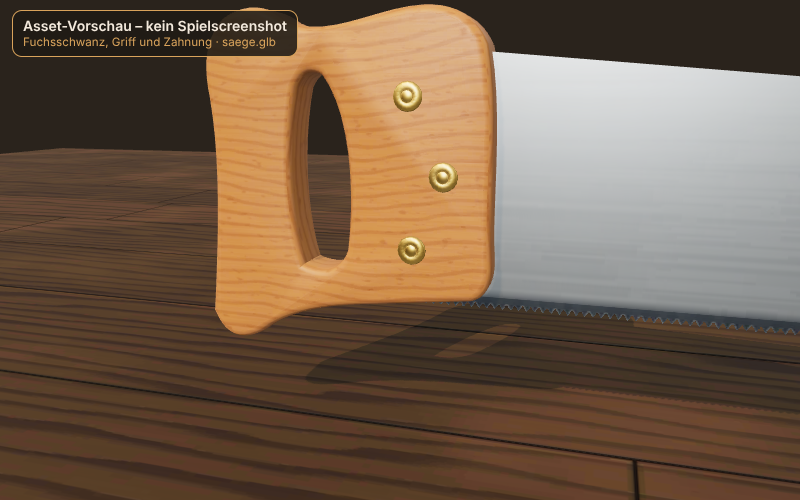
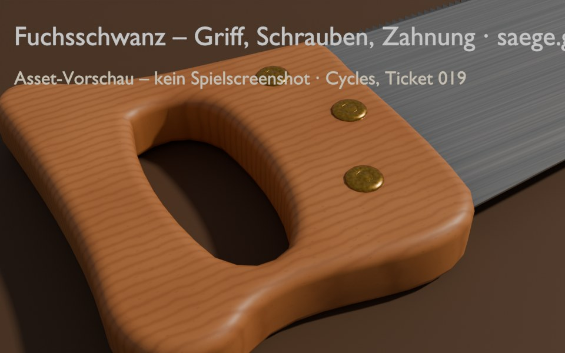
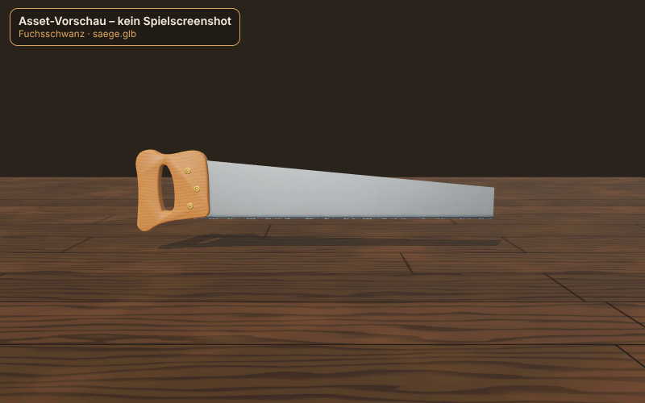
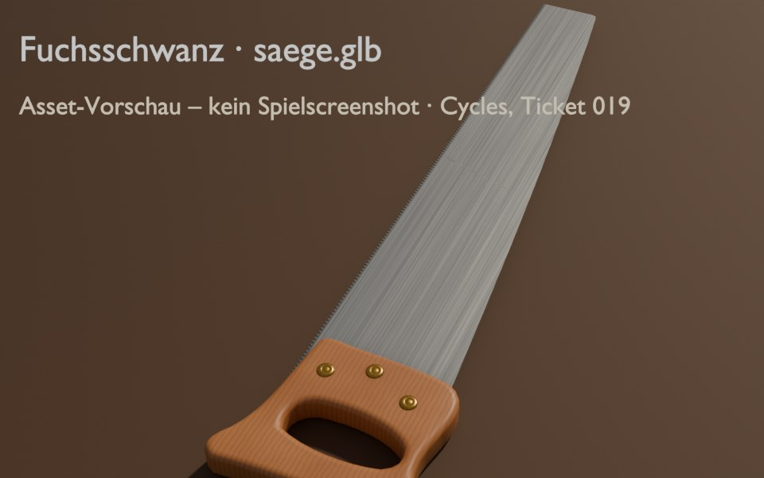
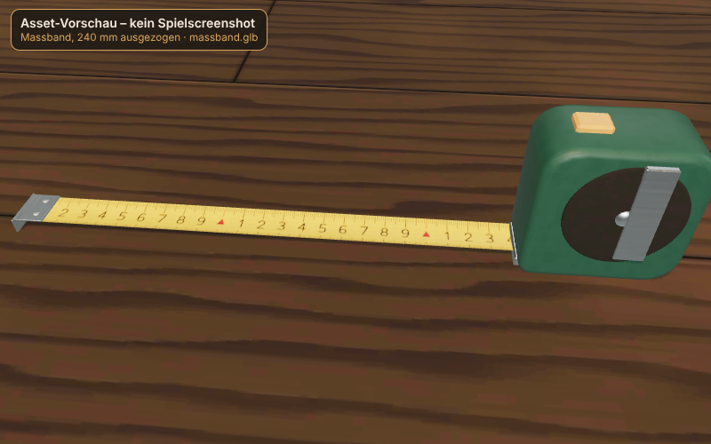
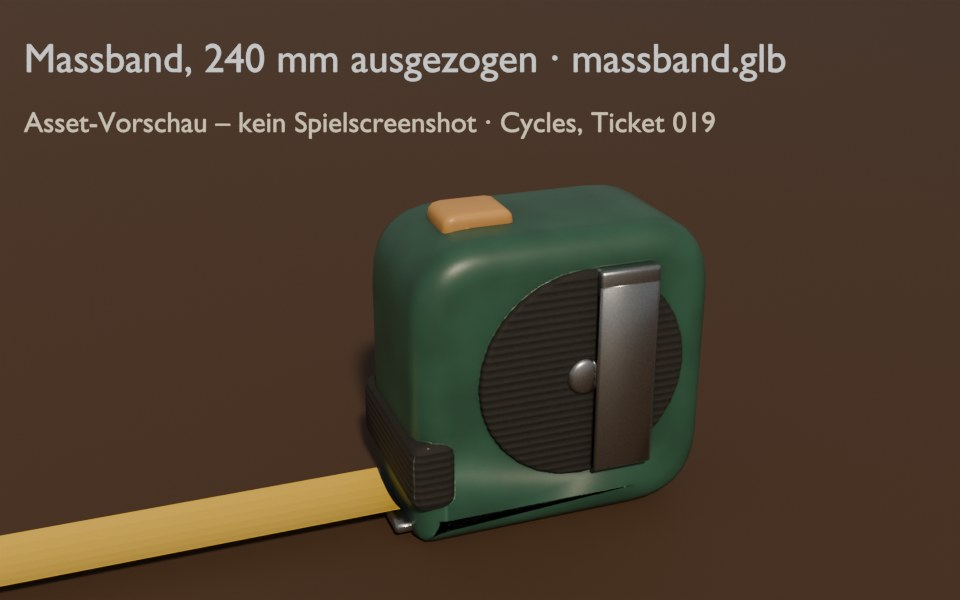
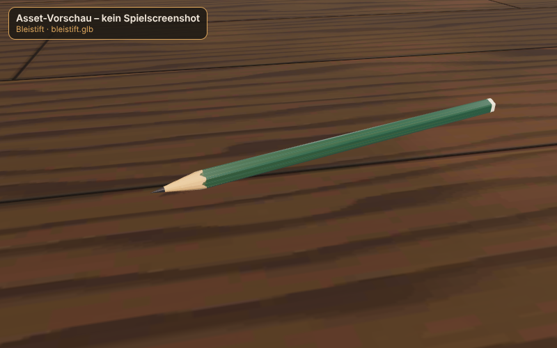
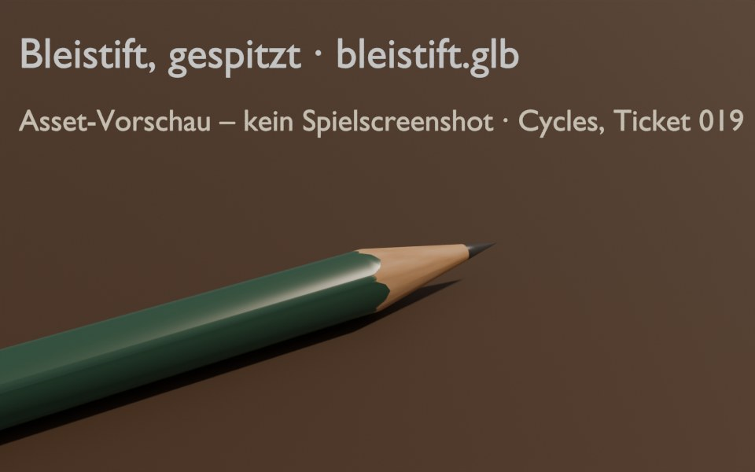
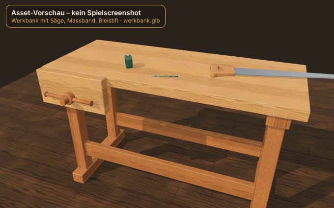
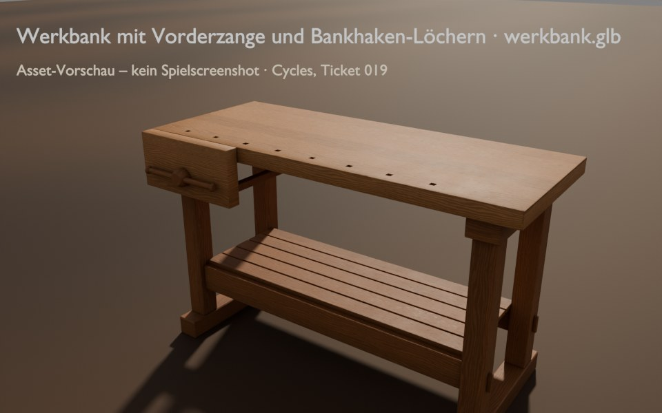

# Werkzeuge und Werkbank aus Blender (Ticket 019)

Status: **Implementiert** · Autor: asset-artist · Stil A „Honigwerkstatt“ · ADR 0005
Vertrag (Knotennamen, Ursprünge, Achsen, Massstab, Materialnamen) unverändert aus `docs/art/assets-phase1.md`;
geprüft mit `node tools/blender/pruefe.mjs <neu.glb> <alt.glb>`.

## Erzeugen

```bash
bash tools/blender/setup.sh                                # Blender 5.2.3 als bpy in .venv-blender/ (~350 MB)
.venv-blender/bin/python tools/blender/alle.py             # alle Modelle + Cycles-Vorschauen (CPU, ca. 20 min)
.venv-blender/bin/python tools/blender/alle.py --ohne-vorschau saege   # einzelnes Modell, ohne Render
node tools/blender/spieltest.mjs                           # Spiel laden + Screenshot (vite preview auf :4591)
```

Je Modell ein Skript (`saege.py`, `massband.py`, `bleistift.py`, `werkbank.py`) mit gemeinsamen Helfern (`hcl.py`):
Geometrie → prozedurale Materialien → Cycles-Bake (Farbe, Rauheit, Metall, **AO**; Normal aus **High-Poly**) in einen
UV-Atlas → GLB-Rohexport + Rohkarten in `tools/blender/build/` (nicht im Repo) → `optimiere.mjs` setzt die Karten als
KTX2 (gleicher Encoder wie `tools/assets/lib/ktx2.mjs`: Farbe/ORM ETC1S, Normal UASTC) und komprimiert Meshes mit
`EXT_meshopt_compression`. Fester Seed 20261101; Bleistift zweimal gebaut → byte-identische GLB.

**Achtung:** `npm run assets:build` (alte Node-Pipeline, Ticket 012) löscht `public/assets/modelle/` und schreibt die
alten Modelle zurück. Für neue Texturen nur noch Modelle aus Blender verwenden (Folgeaufgabe Director: `build.mjs`
auf `--nur-texturen` umstellen oder Modellteil entfernen).

## Vorschau – Asset-Vorschau, kein Spielscreenshot

Cycles (CPU, 32 Samples + Denoise, AgX), warme Sonne + graue Welt; Materialien = die gebackenen Karten.
Vorher-Bilder: Ticket 012, gerendert in three/Chromium (`docs/art/assets-phase1/`).

| Asset | Vorher (012) | Nachher (019) |
|---|---|---|
| Fuchsschwanz nah |  |  |
| Fuchsschwanz |  |  |
| Massband |  |  |
| Bleistift |  |  |
| Werkbank |  |  |

Im Spiel (Chromium, SwiftShader, `?debug=1`, Werkbankansicht): `assets-blender/spiel-werkbank.jpg` –
Spielscreenshot aus Software-Rendering, fps dort nicht aussagekräftig.

## Modelle

| Datei | Dreiecke vorher → nachher (Budget) | Texturen nachher | Grösse vorher → nachher |
|---|---|---|---|
| saege.glb | 3 356 → 3 784 (≤ 5 000) | Blatt 2048×512 Farbe/ORM; Griff 1024² Farbe/Normal/ORM | 568 → 755 kB |
| massband.glb | 2 440 → 2 124 (≤ 3 000) | Gehäuse+Haken 1024² Farbe/Normal/ORM; Band 2048×256 (Skala unverändert) | 209 → 1 077 kB |
| bleistift.glb | 360 → 238 (≤ 500) | 512² Farbe/ORM | 18 → 28 kB |
| werkbank.glb | 1 104 → 1 784 (≤ 4 000) | Eiche 1024² Farbe/Normal/ORM (kachelnd, TEXCOORD_0) + AO 1024² (TEXCOORD_1) | 542 → 720 kB |

Je Modell ≤ 2 Materialien, Draw Calls unverändert (Säge 2, Massband 3, Bleistift 1, Werkbank 4).
`public/assets/` gesamt **4,83 MB** (vorher 3,61 MB; Grenze 6 MB).

### Was neu ist

- **Fuchsschwanz:** Buchengriff als gerundetes Profil (Radius 6/5 mm) mit Griffloch, je Seite drei Messing-Sägemuttern;
  Blatt mit **geometrischer Zahnung** (7 TPI, 165 Zähne, keine Alpha-Maske mehr), Höhe 118 → 62 mm, Dicke 0,9 → 0,75 mm,
  leicht gewölbter Rücken; gebürsteter Stahl, gehärteter Zahnstreifen. Normal-Map aus High-Poly (Griff).
- **Massband:** weich gerundetes Gehäuse, Gummierung beidseitig mit Riffelung (High-Poly → Normal), Gummipuffer über
  dem Austritt, Bernstein-Taste, Gürtelclip, Mittelschrauben. `Band.scale.z = 0` im Ruhezustand.
- **Bleistift:** Sechskant mit Fasen, per Boolean mit einem Kegel gespitzt → echte gewellte Lackkante, Graphitmine,
  getauchte Kappe; zylindrische UV mit 60 % der Textur an der Spitze.
- **Werkbank:** Platte mit 4-mm-Fasen und acht Bankhaken-Löchern (20 × 20 mm), Ablage, Keile; Vorderzange mit Backe,
  Spindel, gedrechseltem Kopf, Knebel mit Knöpfen und zwei Führungsstangen (unter der Platte, sichtbar beim Öffnen).

## Abweichungen und offene Punkte

- **Werkbank-AO auf TEXCOORD_1** statt im ORM: Farbe/ORM kacheln, eine ortsfeste AO geht dort nicht hinein.
  three.js liest `occlusionTexture.texCoord = 1` (aoMap channel 1) ohne Code-Änderung.
- **Massband-Normal-Map** (UASTC, 647 kB) ist die grösste Datei; bei Bedarf auf 512² (≈ 170 kB).
- **Vorher-Bilder** stammen aus three, nicht aus Cycles (die alten GLB nutzen KTX2/meshopt, die der
  Blender-Importer nicht lesen kann).
- **Lint:** `npm run lint` meldet JS-Dateien aus `.venv-blender/` (pip-Paket); `eslint.config.js` braucht
  `.venv-blender/` in den Ignores (Director). Mit `--ignore-pattern '.venv-blender/**'` lint-sauber.
- Nicht auf echtem iPhone/Safari geprüft.
