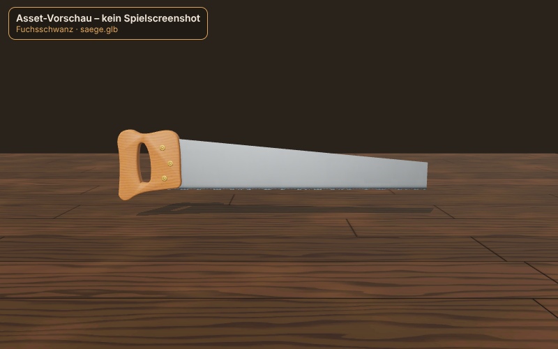
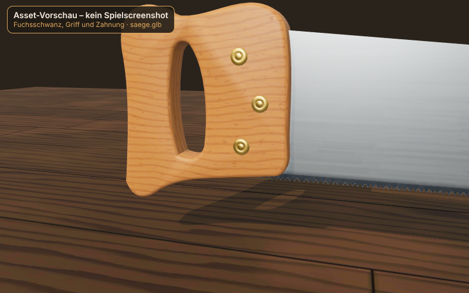
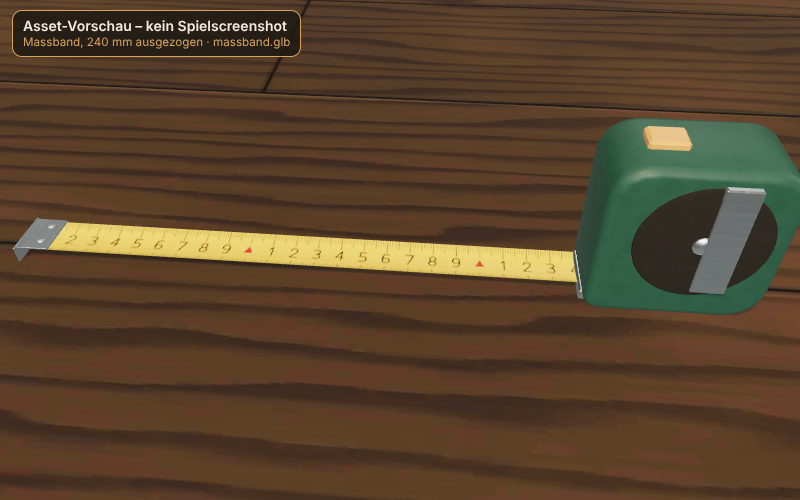
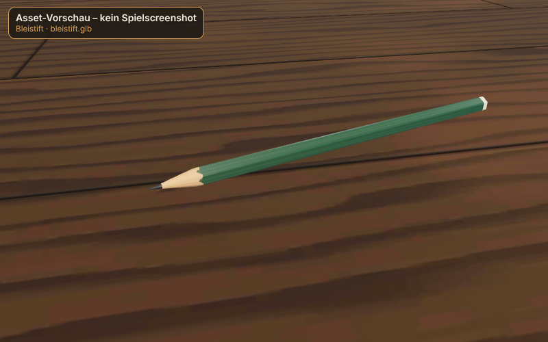
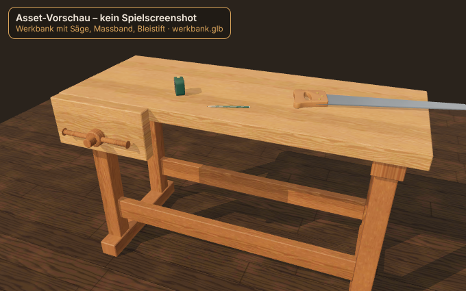
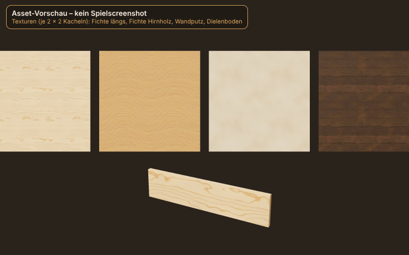

# Werkstatt-Assets Phase 1 (Ticket 012)

Status: **Implementiert** · Autor: asset-artist · Stil A „Honigwerkstatt“
Erzeugung: `npm run assets:build` (≈ 3,5 min, fester Seed 20261101, Ausgabe byte-identisch geprüft).
Vorschau neu rendern: `node tools/assets/vorschau.mjs` (Playwright/Chromium, SwiftShader).

## Vorschau – Asset-Vorschau, kein Spielscreenshot

Gerendert mit three r187 in Chromium (Software-GPU), Sonne warm + RoomEnvironment. Farben und Licht
entsprechen nicht exakt dem iPhone und nicht der späteren Szene (013).

| Asset | Bild |
|---|---|
| Fuchsschwanz |  |
| Fuchsschwanz nah (Griff, Schrauben, Zahnung) |  |
| Massband, 240 mm ausgezogen |  |
| Bleistift |  |
| Werkbank mit Werkzeugen |  |
| Texturen + Brett 600 × 140 × 18 |  |

## Modelle (`public/assets/modelle/`)

| Datei | Dreiecke (Budget) | Materialien | Texturen | Grösse |
|---|---|---|---|---|
| saege.glb | 3 356 (≤ 5 000) | 2: Saege_Blatt (Alpha-Maske), Saege_Griff | Blatt 4096×256 Farbe+Alpha, 2048×128 ORM; Griff 1024² Farbe/Normal/ORM | 568 kB |
| massband.glb | 2 440 (≤ 3 000) | 2: Massband_Gehaeuse, Massband_Band | Gehäuse 512² Farbe/ORM; Band 2048×256 Farbe/ORM | 209 kB |
| bleistift.glb | 360 (≤ 500) | 1: Bleistift | 256² Farbe/ORM | 18 kB |
| werkbank.glb | 1 104 (≤ 4 000) | 2: Werkbank_Platte, Werkbank_Gestell (gleiche Eichentexturen, getönt) | Eiche 1024² Farbe/Normal/ORM (kachelnd) | 542 kB |

Format: glTF 2.0 binär, **KTX2/Basis** (`KHR_texture_basisu`, Farbe/ORM ETC1S, Normal und Alpha-Kanten
UASTC + Zstd), Meshes **`EXT_meshopt_compression`** (beide als `required`). Masseinheit 1 = 1 m.
ORM nach glTF: R = AO, G = Rauheit, B = Metall. Normal-Maps im glTF-/OpenGL-Format (+Y = Bild oben).

### Knoten und Einbau (für Ticket 013)

| Datei | Knoten | Bedeutung |
|---|---|---|
| saege.glb | `Saege` › `Blatt`, `Griff`, `Zahnlinie_Mitte`, `Blattspitze` | Ursprung = Mitte der Griffhand. Blatt zeigt nach −Z, Zähne nach −Y, Blattebene YZ. Zahnspitzen bei y = −55 mm, Blatt 595 mm (≈ 550 frei). |
| massband.glb | `Massband` › `Gehaeuse`, `Band`, `Haken`, `Bandaustritt` | Ursprung = Gehäusemitte. Ausziehen um `mm`: `Band.scale.z = mm/1000`, `Band.material.map.repeat.x = mm/1000` (gleich für `roughnessMap`), `Haken.position.z = Bandaustritt.position.z − mm/1000`. 0 mm am Haken; Skala liest sich aufrecht, wenn der Haken links vom Gehäuse liegt. |
| bleistift.glb | `Bleistift` › `Koerper`, `Minenspitze` | Ursprung = Griffpunkt 35 mm hinter der Spitze, Spitze nach −Z. |
| werkbank.glb | `Werkbank` › `Platte`, `Gestell`, `Vorderzange`, `Arbeitsflaeche` | Ursprung = Boden unter Plattenmitte, Vorderseite +Z, Plattenoberkante y = 0,9 m (`Arbeitsflaeche`). Vorderzange links vorn, Knoten an der Plattenvorderkante, öffnet entlang +Z. |

Laden in three: `GLTFLoader` mit `setKTX2Loader(new KTX2Loader().setTranscoderPath(<three/examples/jsm/libs/basis/>).detectSupport(renderer))`
und `setMeshoptDecoder(MeshoptDecoder)` (aus `three/examples/jsm/libs/meshopt_decoder.module.js`). Die Basis-Transcoder-Dateien
müssen mit ausgeliefert werden. Sägeblatt: `alphaTest` 0,5 aus dem glTF; mit MSAA empfiehlt sich `alphaToCoverage = true`.

## Kachelnde Texturen (`public/assets/texturen/`)

Je `<name>_farbe.ktx2` (sRGB), `<name>_normal.ktx2`, `<name>_orm.ktx2` (linear), 1024², mit Mipmaps, nahtlos kachelnd.
Beim Laden über `KTX2Loader`: `wrapS = wrapT = RepeatWrapping`, Farbe `SRGBColorSpace`, ORM als `roughnessMap` und `aoMap`.

| Name | Kachel physisch | Inhalt |
|---|---|---|
| fichte-laengs | 500 × 500 mm, Faser entlang U | Brettfläche Fichte, Palette `#E3C08D`, Rauheit ~0,7 |
| fichte-hirn | 150 × 150 mm | Hirnholz/Schnittkante: dunkler, poriger, matter (Rauheit ~0,86), Sägespuren |
| wand-putz | 1000 × 1000 mm | Kalkputz warm gebrochenes Weiss, Rauheit ~0,9 |
| boden-dielen | 900 × 900 mm, 6 Dielen à 150 mm | Dunkle geölte Dielen `#3B2A1C`, Fugen mit AO |
| Eiche (in werkbank.glb) | 500 × 500 mm, 5 Lamellen à 100 mm | Verleimte Eichenplatte `#C58F55`, Poren, Spiegel |

Grösse `public/assets/` gesamt: **3,61 MB** (Grenze 6 MB). GPU-Speicher (ASTC/ETC2 nach Transkodierung, mit Mips) grob:
16 × 1024²-Karten + Werkzeugkarten ≈ 26 MB.

## Abweichungen und technische Schuld

- **ESLint:** Die Werkzeugskripte sind `.mjs` ausserhalb der tsconfig-Projekte; `npm run lint` scheitert mit
  „file not found in any of the provided project(s)“. Benötigte Zeile in `eslint.config.js` (Director):
  `{ files: ['tools/**/*.mjs'], ...tseslint.configs.disableTypeChecked },` – damit geprüft: alle Skripte lint-sauber.
- **Massband-Skala:** Kachel 100 mm mit cm-Ziffern 1–9 und roter Dezimetermarke ohne Zahl; Dezimeterzahlen (10, 20 …)
  fehlen. Exakte Werte zeigt die HUD-Lupe (011). Bei Bedarf später zweite UV/Overlay-Textur.
- **Hirnholz:** Jahrringe als flache Bögen (kachelbar), kein Markzentrum.
- **Meshes nicht quantisiert** (Float32 + meshopt); Ersparnis wäre klein, Texturen dominieren die Grösse.
- Fichte-, Hirnholz-/Putz-Normal-Maps (UASTC) sind die grössten Dateien (0,3–0,6 MB); bei Bedarf auf 512² oder ETC1S.
- Vorschau nur in Chromium/SwiftShader geprüft, nicht auf echtem Safari/iPhone.
